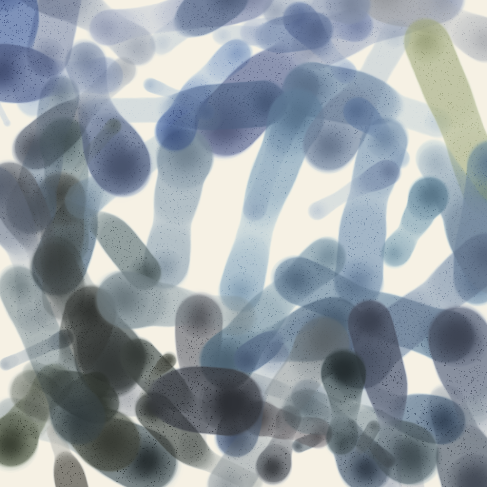

# p5-genetic-painter

> Evolve a painting from a photo: a genetic algorithm breeds brush strokes — colour, position, curve, pressure — and scores each generation on the actual painted pixels, rendered with p5.brush.

*Van Gogh's The Starry Night, mid-evolution — generation 476.*

## Watch it evolve

<video src="docs/genetic-painting-timelapse.mp4" width="512" controls autoplay loop muted playsinline></video>

*The Starry Night, evolved from 9 strokes to 271 over 2,783 generations — 58.8% match, one frame every 25 generations, about 9 seconds at 12 fps.*

## How it works

The genome is a set of brush strokes. Each stroke carries genes for colour, start and end location, curve, width, pressure, opacity, and a random seed. A population of 7 genomes evolves together: each generation, tournament selection picks parents, spatial crossover breeds a child, and mutation nudges, re-aims, grafts or deletes strokes. A child earns its place by beating the population member most similar to it, keeping diversity alive.

Crucially, fitness is measured on the **p5.brush output itself** — every candidate is brushed onto a small fitness canvas with p5.brush and scored on those actual pixels (pixel error plus an edge term), so what you see is literally what was scored. There is no proxy renderer. Renders are seeded, so a genome always paints identically.

- **Stroke bounds:** widths and lengths are clamped to a realistic brush range, and evolution picks the size.
- **Adaptive growth:** when the match stagnates, new finer strokes are added to the genome over time.
- **Fitness chart:** full run history, up to 20,000 generations.
- **Sources:** four built-in images, including Van Gogh's The Starry Night, or upload your own photo.
- **Download:** paint the champion at 1024px as a PNG.

## Run it

Live at https://adamstirtan.github.io/p5-genetic-painter/ (GitHub Pages serves the `docs/` folder), or open `docs/index.html` in a browser (WebGL2 required). The app is a single self-contained file.

## Credits

Brush rendering by [p5.brush](https://github.com/acamposuribe/p5.brush) by Alejandro Campos (MIT licensed), vendored into the page.

## License

MIT — see [LICENSE](LICENSE).
